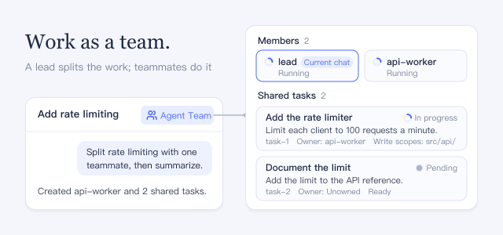

Ask the agent you are talking to, the lead, to split a job. It creates named teammates, puts the work on a shared task board, waits for their results, and reports back.

## How to use

- Ask in plain words, for example: "Use agent teams to split this task between two teammates, wait, and summarize."
- Click **Agent team** next to the conversation title to see **Members** and **Shared tasks**. Each task shows its status, **Owner**, **Write scopes**, and the tasks it is **Blocked by**.
- Click a teammate to open its conversation and talk to it there.
- The panel is read-only. To change tasks or teammates, ask the lead.

## Good to know

- Each teammate is a separate agent with its own model requests, so a team uses more tokens than one agent.
- Teammates share the same files. Overlapping **Write scopes** only show a warning; nothing stops two teammates from editing the same file.
- A team can create at most 8 teammates in total, including ones that failed to start, and hold at most 256 tasks; deleting a task frees a slot.
- While the plugin is on, the ordinary subagent tools are off and agents delegate through the team; workflows still start one-shot agents. Turning the plugin off restores the subagent tools.
- After turning it on with a conversation open, reload the page to see the panel.
