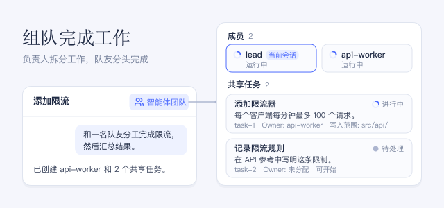

让与你对话的智能体（即负责人）拆分一项工作。它会创建有名字的队友，把工作放到共享任务看板上，等待他们的结果，再向你汇报。

## 使用方法

- 用平常的话提出要求，例如：「用智能体团队把这个任务分给两名队友，等他们完成后汇总结果。」
- 点击对话标题旁的 **智能体团队**，查看 **成员** 和 **共享任务**。每个任务显示状态、**Owner**、**写入范围**，以及它的 **依赖**。
- 点击一名队友可打开它的对话，并在那里与它交谈。
- 面板是只读的。如需修改任务或队友，请告诉负责人。

## 注意事项

- 每名队友都是独立的智能体，各自发起模型请求，因此团队比单个智能体消耗更多 token。
- 队友们共用同一批文件。**写入范围** 重叠时只显示警告，不会阻止两名队友修改同一个文件。
- 一个团队总共最多创建 8 名队友（包括启动失败的队友），最多保有 256 个任务；删除任务会空出一个名额。
- 启用此插件后，普通的子智能体工具会关闭，智能体通过团队分派工作；工作流仍可启动一次性智能体。关闭此插件后，子智能体工具会恢复。
- 如果在对话打开时启用此插件，请刷新页面以显示团队面板。
