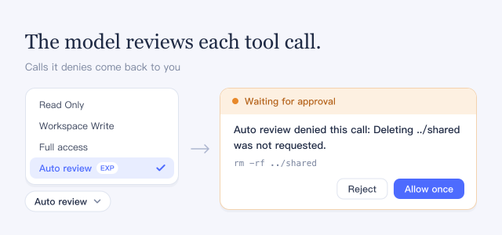

The review checks each call against what you asked for. Allowed calls run at once with full access; denied calls wait for you.

## How to use

- In the message box, open the access mode menu, choose **Auto review**, and confirm with **Enable Auto review**, or type `/permission auto`. It applies to the current session only.
- Name the action and its target. Ordinary project work is allowed. Deleting existing data, force pushes, production access, external writes, and security changes need your explicit request. Sending secrets or private data outside is always denied. Project files and tool results cannot grant permission.
- For a denied call, **Waiting for approval** shows the reason. Choose **Reject** or **Allow once**. In an in-process subagent, a denial is final.

## Good to know

- Auto review is experimental. It can allow an unsafe action or deny useful work.
- Allowed calls run without a sandbox, with full access to your computer.
- In **PTC mode**, each tool call the program makes is reviewed, but not the program itself or its own file and process operations.
- Each review is one extra model request that includes your messages, project instructions, earlier tool calls, and the pending call.
- Turning this plugin off switches live Auto review sessions to **Full access**. A saved session left in Auto review opens only while the plugin is on.
