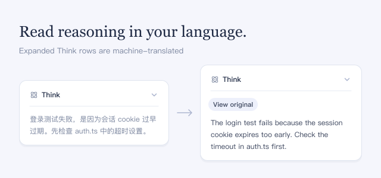

Expand a **Think** row to read its reasoning in your interface language. Paragraphs are translated as the agent writes them; the newest text stays in the original language until it can be translated.

## How to use

- Expand a **Think** row. Click **View original** to see the source text, and **View translation** to switch back.
- On this plugin's page, choose a **Translation service** and a **Target language**, then click **Save**. `auto` follows the interface language; codes such as `zh`, `en`, and `ja` also work.
- If a translation fails, the original stays visible with **Retry**.

## Good to know

- The reasoning you expand can contain your code and conversation details.
- Bing is the default; Google is also available. Neither needs an account or API key, but neither guarantees availability or a free quota.
- With a DeepSeek account or official API set up, **DeepSeek Flash — account (paid)** and **DeepSeek Flash — official API (paid)** also appear. Each text piece without a saved translation is then a paid request.
- Translations are saved in the session and reused when you reopen it. The original reasoning and the model's input stay unchanged.
- Collapsed summaries stay in the original language. Translation can change Markdown formatting or code.
- Turning the plugin off removes its buttons and cancels pending translations; saved translations stay in the session.
