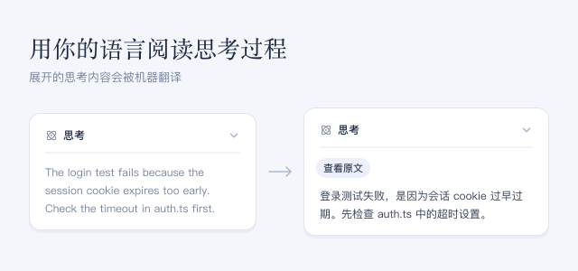

展开 **思考** 行，即可用界面语言阅读其中的思考内容。智能体输出时会逐段翻译；最新的内容在能够翻译之前保持原文。

## 使用方法

- 展开 **思考** 行。点击 **查看原文** 显示原文，点击 **查看译文** 切换回译文。
- 在此插件的页面中选择 **翻译服务** 和 **目标语言**，然后点击 **保存**。`auto` 表示跟随界面语言；也可以填写 `zh`、`en`、`ja` 等语言代码。
- 翻译失败时，原文保持显示，并提供 **重试**。

## 注意事项

- 你展开的思考内容可能包含你的代码和对话细节。
- 默认使用 Bing，也可以选择 Google。两者都无需账号或 API key，但都不保证可用，也不保证免费额度。
- 如果已配置 DeepSeek 账号或官方 API，还会出现 **DeepSeek Flash · 账号（付费）** 和 **DeepSeek Flash · 官方 API（付费）**。此时每段没有已保存译文的内容都是一次付费请求。
- 译文保存在会话中，重新打开时直接复用。原始思考内容和模型的输入都不会改变。
- 折叠时显示的摘要保持原文。翻译可能改变 Markdown 格式或代码。
- 关闭此插件会移除它的按钮并取消未完成的翻译；已保存的译文仍保留在会话中。
