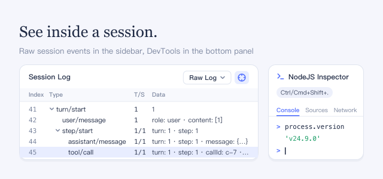

Use it when troubleshooting: check exactly what DSH recorded for a session, or debug DSH itself in Chrome DevTools. It does not change how the agent works.

## How to use

- In the right sidebar, click **+** (**New tab**), then choose **Session log** on the **Start** page that opens.
- **Raw log** lists the session's events grouped by turn and step; click a row to see its full data. Switch the selector to **Chat group** to see the chat messages and their groups instead.
- Click the crosshair button next to the selector, then click a message in the chat to find its record. Press Esc to cancel.
- Press **Ctrl+Shift+.** (**Cmd+Shift+.** on macOS) to open or collapse **NodeJS inspector** at the bottom of the window: Chrome DevTools, in English, connected to the DSH backend.

## Good to know

- Neither view sends anything to the model or uses tokens.
- While this plugin is on, DSH keeps in memory the network requests its backend sends, such as model API calls: full URLs, request and response headers, and bodies up to a size limit, without hiding API keys or cookies. This uses extra memory.
- The debugging endpoint on 127.0.0.1 has no password: any program on this computer can connect to it and run code inside DSH. Turn the plugin off when you are not debugging; this stops the recording and closes the endpoint.
