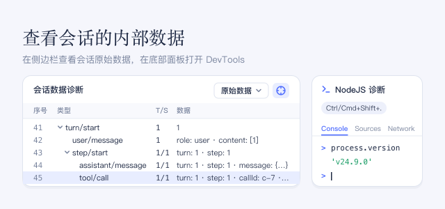

排查问题时使用：准确查看 DSH 为一个会话记录了什么，或在 Chrome DevTools 中调试 DSH 本身。它不会改变智能体的工作方式。

## 使用方法

- 在右侧栏点击 **+**（**新标签页**），然后在打开的 **开始** 页中选择 **会话数据诊断**。
- **原始数据** 按轮次和步骤分组列出会话的事件，点击一行可查看完整数据。将选择器切换为 **对话分组**，可改为查看聊天消息及其分组。
- 点击选择器旁的准星按钮，再点击对话中的一条消息，即可找到它对应的记录。按 Esc 取消。
- 按 **Ctrl+Shift+.**（macOS 上为 **Cmd+Shift+.**）可在窗口底部展开或收起 **NodeJS 诊断**：它是连接到 DSH 后端的 Chrome DevTools，界面为英文。

## 注意事项

- 这两个视图都不会向模型发送内容，也不消耗 token。
- 启用此插件后，DSH 会在内存中保留其后端发出的网络请求（例如模型 API 调用）：完整 URL、请求头和响应头，以及不超过大小上限的请求体和响应体，不会隐藏 API key 或 cookie。这会占用额外内存。
- 127.0.0.1 上的调试端点没有密码：这台计算机上的任何程序都可以连接它，并在 DSH 内部运行代码。不调试时请关闭此插件，这会停止记录并关闭该端点。
