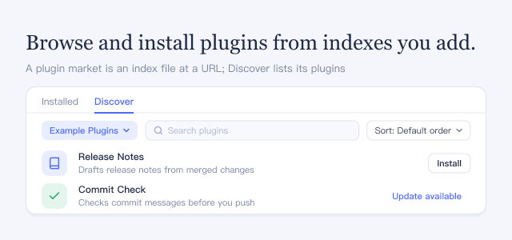

A plugin index is a file at a URL that lists plugins. Add the URL, and its plugins appear in **Discover**, where you can browse and install them. DSH comes with no index; you choose which indexes to add.

## How to use

- Open **Plugins**, select **Discover**, click **Add index source**, enter the **Index URL**, and click **Add**. To add another index later, open the index menu and choose **Manage index sources…**.
- Click a plugin to read its details, then click **Install** and confirm.
- A plugin you have shows **Installed**, or **Update available** when the index recommends a newer version; click it to open the plugin under **Installed**.

## Good to know

- DSH contacts an index only after you add it.
- Plugins in an index come from third parties and run with your permissions. Add only indexes you trust.
- To update a plugin installed from npm, use **Update** in its **Versions** section under **Installed**; installing another npm version from the index fails until you uninstall it. A plugin installed from Git has no **Versions** section; to change its version, uninstall it and install it again from the index.
- Plugin details come from public npm file services (jsDelivr, unpkg, npmmirror) or the plugin's Git repository, with your Git credentials for private ones. Icons load directly from the addresses in the index, so those servers see your IP address.
- In **Creator mode**, the agent also gets a read-only `plugin_market` tool, which adds a few tokens to each request.
- Turning this off removes **Discover** and the `plugin_market` tool; your index sources and installed plugins stay.
