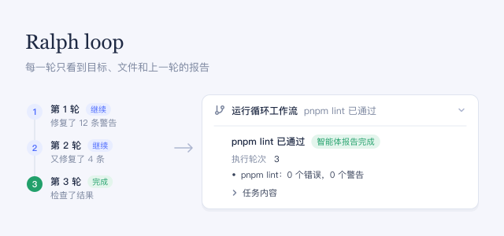

给出目标并要求使用 Ralph 循环后，智能体会一轮接一轮地启动新的智能体处理这个目标，直到某一轮报告目标已达成或受阻，或达到轮次上限。每一轮只能看到目标、工作区文件和上一轮的简短报告，看不到对话内容。

## 使用方法

- 说「Ralph 循环」，并给出能根据文件检查的目标，例如：「用 Ralph 循环把 pnpm lint 修到零警告通过，最多跑 5 轮。」
- 循环在对话中显示为 **运行循环工作流**，并标记为 **智能体报告完成**、**智能体报告受阻** 或 **已达到轮次上限**。展开后可查看最后一份报告、**执行轮次**、**待完成事项**（如有）和 **任务内容**。

## 注意事项

- 智能体被要求只在你要求 Ralph 循环、或要求用新的智能体反复工作时才使用它。
- 完成和受阻都是最后一个智能体自己的报告。请自行检查结果。
- 某一轮没有写进文件或报告的内容都会丢失。如果某一轮没有给出有效报告，循环会出错停止。
- 对话会等待整个循环结束。停止回复会同时停止循环。
- 一个循环最多运行 64 轮，要求更多轮次会失败。每一轮都是一次完整的智能体运行，因此成本随轮数增加。
- 关闭此插件后，每个智能体的下一次请求中都不再有这个循环。
