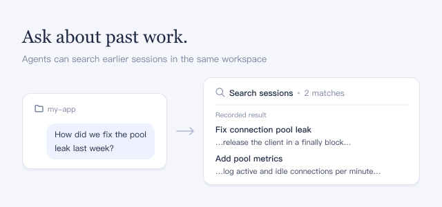

Ask about earlier work, such as "How did we fix the pool leak last week?", and the agent finds the answer in your earlier sessions. You do not need to paste the history.

## How to use

- Ask about past work in your message. The agent decides when to search.
- Expand a **Search sessions** row to see the matching sessions with their titles and matching excerpts.

## Good to know

- Agents see only sessions whose working directory is exactly the same path as the current one; a symlinked path counts as different.
- Agents can read earlier sessions but cannot change them.
- The search index is built on the first search and kept in memory. It is built again after DSH restarts or after the plugin is turned off and on.
- The search tools and their instructions are added to every model request, so they use some tokens even when the agent does not search.
- Turning the plugin on or off changes the agent's tools from its next request, also in open sessions; that request cannot reuse cached input.
- The search box in the sidebar works the same with or without this plugin.
