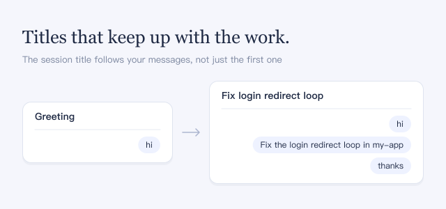

Without this plugin, a session's title is written once from your first message, so a session that starts with "hi" keeps a title such as "Greeting". With it on, the title is written from all of your messages and changes when the main task of the session changes.

## Good to know

- Each new message from you starts one short title request, using the same model as the conversation. This costs some extra tokens; the agent's own requests do not grow.
- The model is asked to keep the current title while it still describes the main task, so follow-up questions or "thanks" usually leave it unchanged. The model can still reword it.
- Automatic updates never change a title you renamed yourself.
- If a title request fails, the previous title stays. Once your messages in a session add up to more than about 4 KB of text, title requests fail and the title stops changing.
- It applies to existing and new sessions. Turning it off stops automatic updates; new sessions again get their title from the first message, and titles already written stay.
