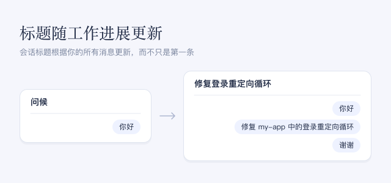

未启用此插件时，会话标题只根据你的第一条消息生成一次，因此以“你好”开头的会话会一直使用“问候”之类的标题。启用后，标题根据你的所有消息生成，并在会话的主要任务变化时更新。

## 注意事项

- 你每发送一条新消息，都会发起一次简短的标题请求，使用与对话相同的模型。这会消耗一些额外 token；智能体自身的请求不会变长。
- 只要当前标题仍能概括主要任务，模型就会被要求保留它，因此追问或“谢谢”之类的消息通常不会改变标题。模型仍可能改写标题。
- 自动更新不会更改你自己重命名过的标题。
- 标题请求失败时，保留原来的标题。会话中你的消息累计超过约 4 KB 文本后，标题请求会失败，标题不再变化。
- 它对已有会话和新会话都生效。关闭后停止自动更新；新会话重新根据第一条消息生成标题，已生成的标题保持不变。
