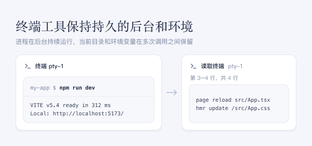

此插件为智能体提供终端工具，这些工具保持持久的后台和环境：进程在后台持续运行，当前目录、导出的环境变量和 shell 函数在多次工具调用之间保留。智能体可以启动开发服务器、文件监视程序、调试器或 REPL，在它运行期间进行其他工具调用，稍后再回来读取新输出或继续输入。

## 使用方法

- 提出需要持续运行的工作，例如“在终端里启动开发服务器，改完代码后检查它的输出”。
- 每个终端步骤都会以工具调用的形式显示在对话中：**创建终端**、显示所发送文本及其输出的终端卡片、**读取终端**、**发送终端信号**、**查看终端** 和 **关闭终端**。
- 终端归智能体所有：你通过这些工具调用查看终端，无法自己在其中输入。侧边栏终端与此无关：那是你自己的 shell，智能体看不到它。只有打开终端的智能体才能使用它。macOS 和 Linux 使用 Bash；Windows 使用 PowerShell。

## 注意事项

- 终端在会话的当前文件夹中启动，并按会话的访问模式运行。终端打开期间，无法切换到文件访问权限不同的访问模式；请先让智能体关闭它的终端。
- 智能体读取的输出会加入对话并消耗 token；默认每个结果最多 256 KB。
- 不支持全屏终端程序。
- DSH 重启或关闭此插件时，终端会停止。需要保留的结果请写入文件。
- 开启或关闭此插件会改变已打开会话的工具。这些会话的下一次请求无法复用提示词缓存，因此这一次会更慢、费用更高。
