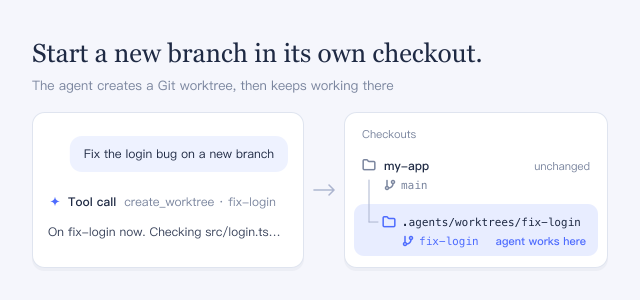

Ask for work on a new branch, and the agent moves to a separate folder for it. Your current checkout and its uncommitted changes stay as they are.

## How to use

- Ask the agent to work on a new branch, optionally naming it and a local branch, tag, or commit to start from. By default it starts from your current commit with a generated `worktree-` name.
- The conversation shows a **Tool call** row for `create_worktree`; expand it for the new path and branch.
- To go back, ask the agent to switch to your main checkout. The new checkout and branch stay.

## Good to know

- The checkout is created at `.agents/worktrees/<name>` in your current checkout. When DSH creates that folder, it adds a `.gitignore` so Git ignores it.
- Only committed files are checked out: uncommitted and ignored files such as `node_modules` are not copied, submodules are not initialized, and dependencies are not installed. DSH does not fetch from the remote, and Git LFS files stay as pointers.
- The call fails if the branch or folder exists, or if the access mode does not allow writing the folder and the repository's Git data. A failed call can leave a partial checkout; the error shows its path.
- Turning this plugin off keeps the checkouts and branches it created; remove them with Git.
